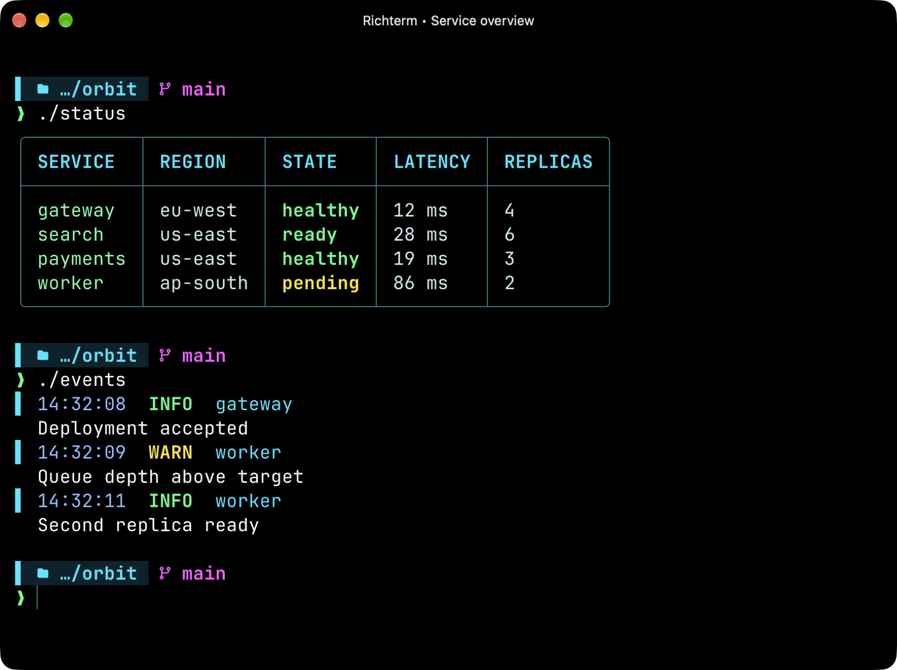
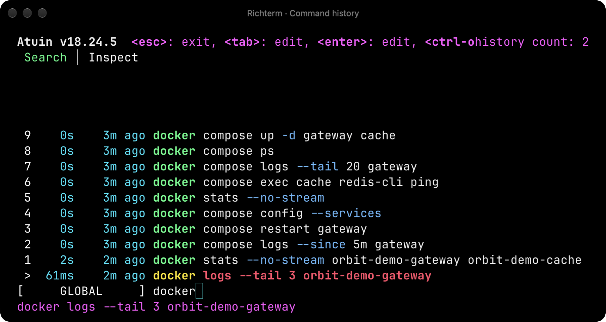
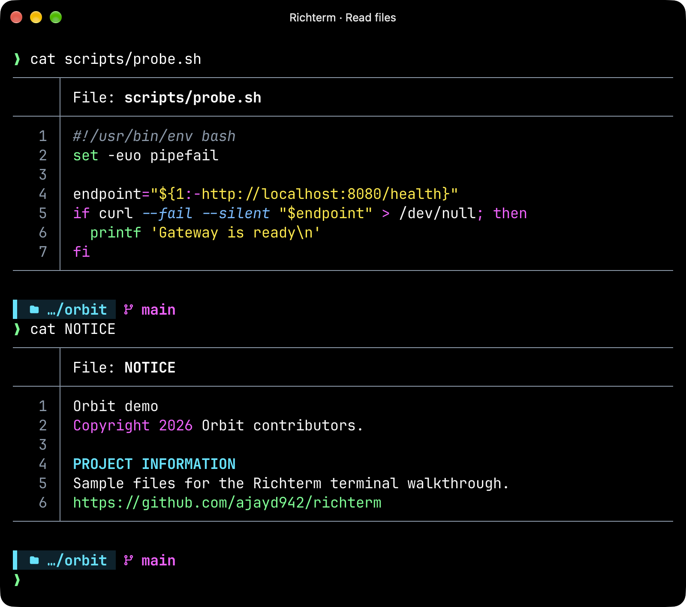
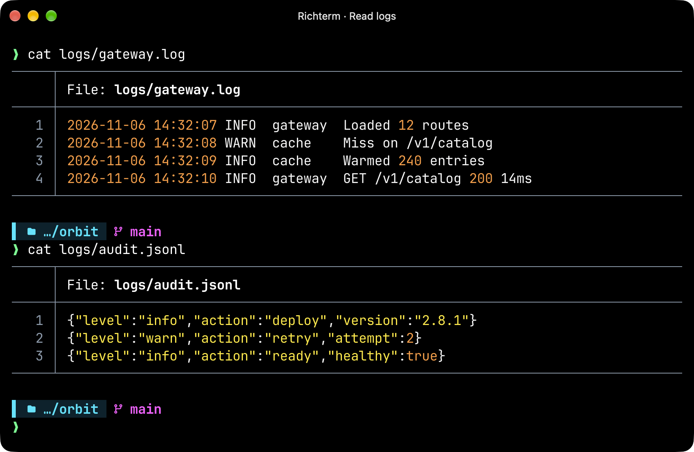
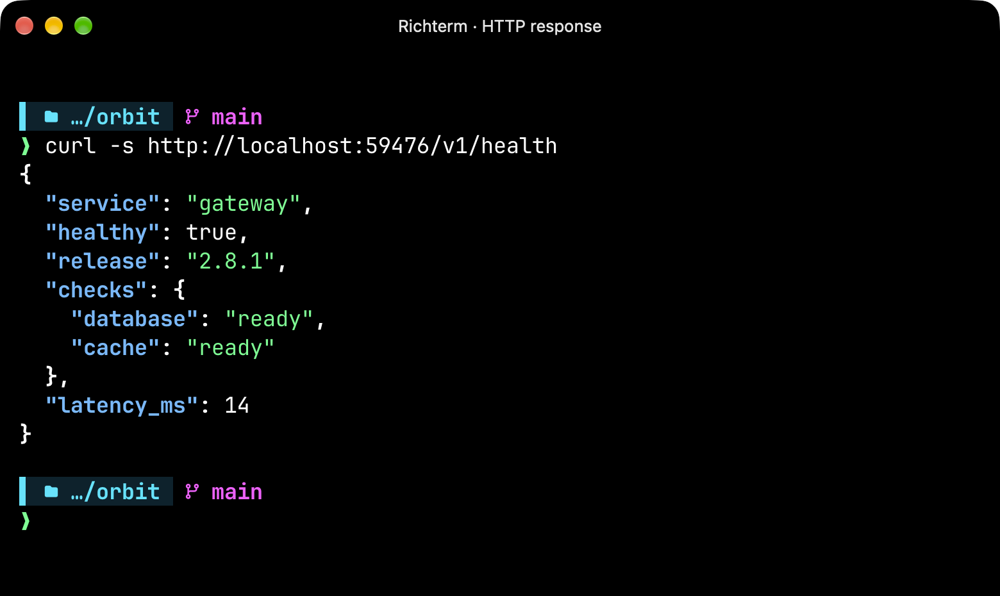
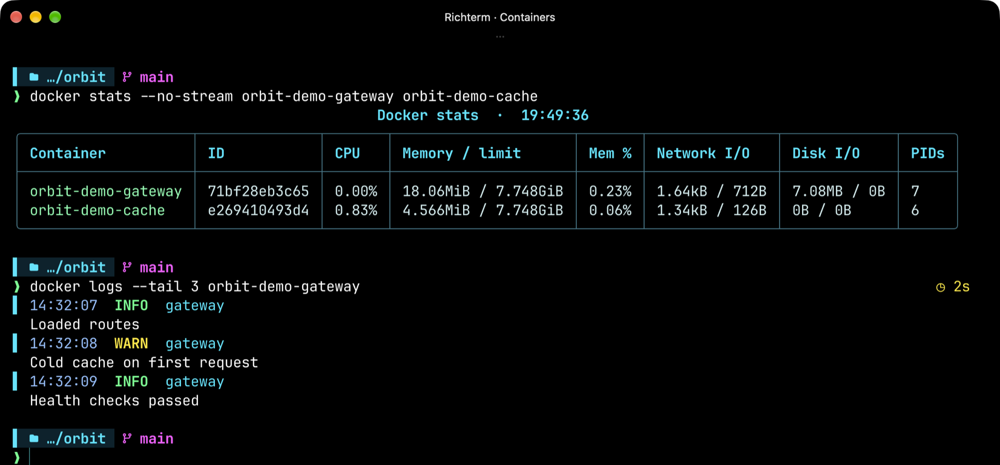
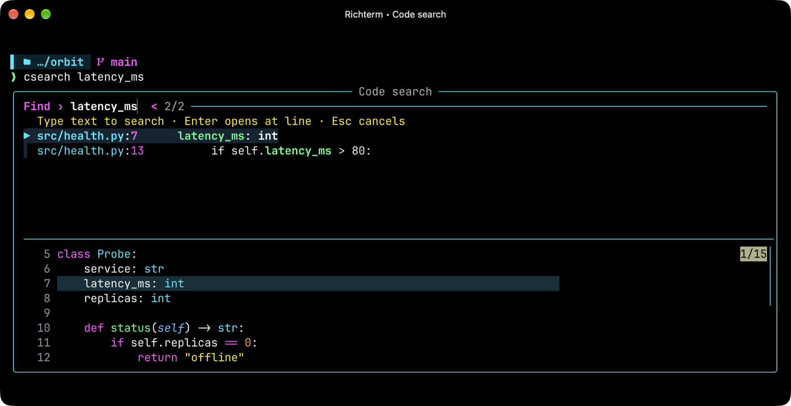
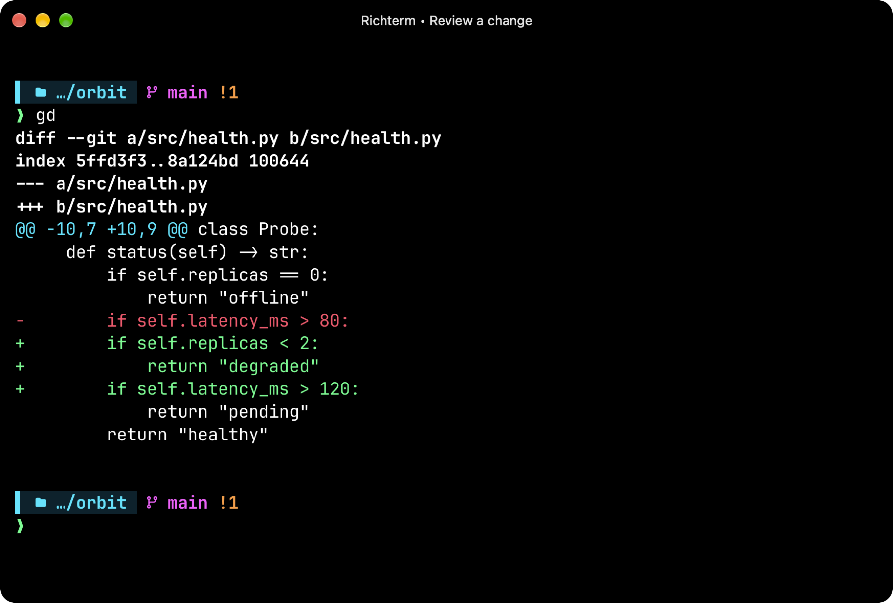

# Richterm

A macOS terminal for people who spend their day reading code, logs, and command output. Keep typing your usual commands. Richterm turns recognizable reports into tables and makes warnings stand out as logs arrive.



The two demo scripts above print ordinary CSV and JSON logs. Richterm does the styling. See it in action with [command history](#recall-a-command), [files](#read-a-file-with-cat), [log files](#scan-a-log-file), [curl](#inspect-an-api-response), and [Docker](#check-your-containers).

## Get started

You'll need macOS, [Homebrew](https://brew.sh/), and Git. The installer sets up Ghostty, the font, and the developer tools. **It backs up and replaces matching settings, including `~/.zshrc` and `~/.vimrc`.** See the [setup and recovery guide](docs/guide.md) if you already have a customized shell.

```sh
git clone https://github.com/ajayd942/richterm.git
cd richterm
./install.sh
open -a Ghostty
```

Open a new tab and type **`desk`** to explore. For a quick first look, paste this into the prompt:

```sh
printf 'SERVICE\tSTATE\napi\tready\nworker\tpending\n'
```

## Recall a command

Remember running a Docker command but forgot the flags? Press **Ctrl-R** and type `docker`. Choose a match and press **Enter** to put it back on the prompt for editing. The history in this demo was seeded with sample commands.



## Read a file with cat

Type `cat scripts/probe.sh` to see shell keywords, strings, and line numbers. The same viewer recognizes Python, Java, JSON, and many other formats. Even an extensionless `NOTICE` gets readable headings and links.



## Scan a log file

Use `cat` on a saved log too. In the text log below, timestamps line up on the left. In the JSON Lines audit log, each event stays on its own numbered line.



## Inspect an API response

This local health endpoint sends a single line of JSON. With just `curl -s`, Richterm indents the nested checks and highlights the keys so you can spot the cache status at a glance.



## Check your containers

`docker stats --no-stream` puts CPU and memory side by side for two running services. `docker logs` brings the message and its severity forward. Add `-f` to watch new entries as they arrive.



## Find the line you need

Run `csearch` and type a fragment you remember. Move through the matches to see each line in context. Press **Enter** to open the selected line in your editor.



## Review a change

Inside a Git repository, `gd` shows your unstaged changes. Here a patch adds a health check and raises a latency threshold. For a larger review, `lg` opens the interactive Git browser.



Browse files with `y` or read Markdown with `md README.md`. For SSH, keyboard shortcuts, and plain-shell recovery, see the [full guide](docs/guide.md).
